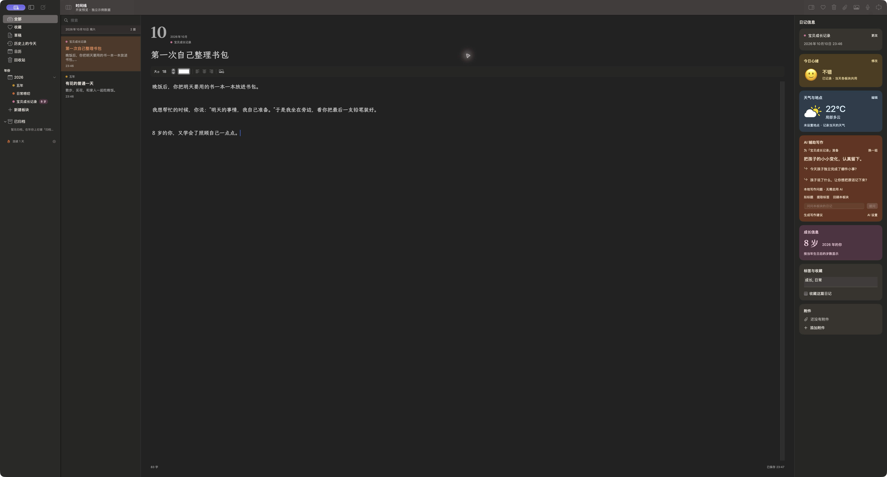

# Wuyan

[中文说明](README.md)

Wuyan is a native macOS private journal. It is local-first and brings your timeline, notebooks, moods, weather, media, and writing assistance into one quiet workspace.

The latest version is **v1.5.0**. This release adds yearly themes, year archives, and annual PDF yearbooks while keeping the local database, sync, encryption, AI assistance, rich-text editing, and export workflows.



## Features

- **Local-first journal**: SQLite stores entries, notebooks, tags, moods, drafts, and media indexes. The app supports rich text, favorites, Trash, and full-text search.
- **Notebook organization**: Organize entries into daily life, growth, reading, or custom notebooks. A writing ritual helps choose a notebook and today's mood when starting an entry.
- **Daily context**: Record moods, weather, temperature, location, writing streaks, and memories from this day in previous years.
- **Media attachments**: Import photos, audio, and video. Media is stored by content address and can be thumbnailized locally.
- **Cross-device sync**: Sync through WebDAV/NAS or S3-compatible storage. Manifests, content hashes, conflict copies, and tombstones prevent silent overwrites.
- **Remote encryption**: Optionally encrypt objects uploaded to WebDAV or S3 with AES-GCM. Passwords, sync passphrases, and AI keys are stored in the macOS Keychain.
- **AI-assisted writing**: Supports Ollama, Claude, and Zhipu providers for writing prompts, titles, tags, daily sentences, and retrieval-based questions over local journal context.
- **Export and archiving**: Export to Word, generate annual PDF yearbooks, and archive to WebDAV/NAS or encrypted local files. Local content is removed only after archive verification, with an audit record retained.
- **Privacy and daily use**: Diary lock, writing reminders, streak statistics, light/dark themes, and window restoration are included.

## Download

Download the latest macOS package from [GitHub Releases](https://github.com/a136850519-alt/wuyan/releases/latest).

The release package requires **macOS 14 or later**. Local builds are not notarized by Apple. On first launch, macOS may require you to approve the app in **System Settings > Privacy & Security**, or to right-click the app in Finder and choose **Open**.

Production distribution requires a Developer ID signature and Apple notarization. The local packaging scripts are intended for development and maintainer builds.

## Run From Source

Requirements:

- macOS 14 or later
- Swift 5.9 or later
- Xcode or Xcode Command Line Tools

From the project root:

```sh
swift build
swift run Wuyan
```

Run the test suite:

```sh
swift test
```

You can also open `Package.swift` in Xcode and run the `Wuyan` scheme.

## Build an Installer

Build the release binary:

```sh
swift build -c release
```

Build a `.app` bundle and DMG locally:

```sh
bash Release/build-local.sh
```

The script requires a clean worktree and a code-signing certificate named `Wuyan Local Signing` in the macOS Keychain. Set `WUYAN_SIGNING_IDENTITY` to use another identity. The default output is `dist/Wuyan.app` and `dist/Wuyan.dmg`.

See [`Release/RELEASING.md`](Release/RELEASING.md) for signing, notarization, and release procedures.

## Sync and AI Configuration

Configure WebDAV/NAS from the command line:

```sh
bash Release/configure-webdav.sh --url https://your-nas:5006/dav --username your-user
```

Configure an S3-compatible backend:

```sh
bash Release/configure-s3.sh
```

The in-app settings page can also configure the storage backend, encryption passphrase, and AI provider. Remote passwords, S3 secret keys, AI API keys, and sync passphrases are stored in the macOS Keychain. URLs, usernames, and model names are stored as non-sensitive user defaults.

Remote encryption protects objects uploaded to WebDAV/S3. It does not automatically encrypt the local SQLite database, media cache, or AI index. Use FileVault, a protected macOS account, and appropriate disk permissions for local protection.

## What's New in v1.5.0

- Save a preset or custom theme for each year, with HEX input and the system color picker; existing theme settings remain compatible.
- Archive a year to WebDAV/NAS or an encrypted local file. The app verifies the archive before removing local content and retains archive change records.
- Export an annual PDF yearbook in A5 or A4 using plain collection, journal, or album styles, with optional entries, day notes, tags, photos, and audio/video descriptions.
- Explicitly clear a day's mood so an old entry mood cannot reappear through compatibility projection.
- Keep Word export, diary lock, rich-text editing, and WebDAV diagnostics.

All devices sharing one NAS should be upgraded to a version supporting `daynote-mood` before recording or syncing daily moods. See [`Release/RELEASE_NOTES_NEXT.md`](Release/RELEASE_NOTES_NEXT.md) for the full release notes.

## Repository Layout

```text
Wuyan/                  SwiftUI app, domain models, local database, sync, and exports
WuyanTests/             Unit, regression, export, and sync tests
WebPreview/              Standalone web UI preview
Release/                Version metadata, icons, signing, notarization, and packaging scripts
script/                 Development preview and run scripts
docs/                   Interface verification records, screenshots, and reviews
Package.swift           Swift Package Manager manifest
MIGRATION.md            Portable-disk and app-data migration notes
```

## Data and Migration

Application data is stored in the sandbox container:

```text
~/Library/Containers/com.wuyan.app/Data/Library/Application Support/Wuyan
~/Library/Containers/com.wuyan.app/Data/Library/Preferences/com.wuyan.app.plist
~/Library/Containers/com.wuyan.app/Data/Library/Caches/Wuyan
```

When moving to another Mac, launch and quit the app once, then follow [`MIGRATION.md`](MIGRATION.md). Keychain items do not move with copied files; WebDAV, S3, AI, and sync credentials must be entered again on the new Mac.

Do not commit `AppData/`, database snapshots, exports, or credentials. The repository's `.gitignore` excludes these local files.

## Scope

Wuyan is currently a native macOS app. iOS, iCloud, and CloudKit are not supported. Real NAS/S3 integration, notification and location permissions, online AI providers, and Developer ID notarization require validation in their respective environments.

## License

This repository does not currently declare an open-source license. Do not redistribute or use the code, designs, fonts, or other assets for commercial purposes without explicit permission from the project maintainer.
